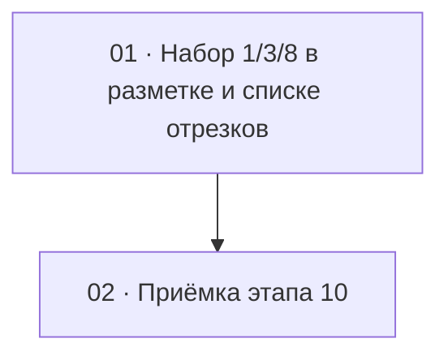

# Этап 10 — Набор длительностей отрезков: 1, 3, 8 секунд

Статус этапа: не выполнен. Сводка — [status.md](../status.md).

Источник: [03-technical-specification.md, раздел «Этап 10»](../../03-technical-specification.md#этап-10--набор-длительностей-отрезков).
Серверная сторона — этап 15 в `quizbeat-srv`
(`documentation/tasks/step-15/`), особенно
[задача 1](../../../../quizbeat-srv/documentation/tasks/step-15/01-clip-durations-set.md).
Решение заказчика (2026-10-11): оставить длительности 1, 3, 8 секунд —
для нарезки и для обоих игровых режимов. **Этап блокируется серверным
этапом 15:** до него сервер принимает прежний набор.

Формат файлов — по [task-writing-guidelines.md](../task-writing-guidelines.md).

## Граф зависимостей

## Список задач

| # | Задача | Зависит от | Файл | Статус |
|---|--------|------------|------|--------|
| 1 | Набор 1/3/8 в форме разметки; отображение наследованных отрезков | серверный этап 15 (задача 1), [этап 5](../step-5/README.md) | [01-clip-durations-set.md](./01-clip-durations-set.md) | не выполнена |
| 2 | Приёмка этапа 10 целиком | 1 | [02-step10-acceptance.md](./02-step10-acceptance.md) | не выполнена |

## Решения этапа

- **Форма разметки предлагает только 1, 3, 8.** Кнопка «три точки сразу»
  (1, 3, 8 от текущего старта) уже есть — остаётся, но перестаёт быть
  особой: это «все допустимые длительности».
- **Наследованные отрезки (2, 5, 13, 21 сек) остаются в списке.** Сервер
  отдаёт их в `GET .../clips` как раньше; их можно прослушать, удалить и
  перегенерировать. Список не фильтруется и не ломается на «чужой»
  длительности (`durationSec` в ответе — число, не union допустимых).
  В игровой API они не попадают — подсказка в блоке отрезков об этом
  говорит.
- **Несколько отрезков одной длительности и сложности допустимы** —
  отличаются временем старта. Форма не должна запрещать вторую точку с
  той же парой «длительность + сложность» при другом старте, в списке
  отрезки различимы по старту.
- Источник истины по набору — сервер; клиентская константа — зеркало и
  подсказка.
