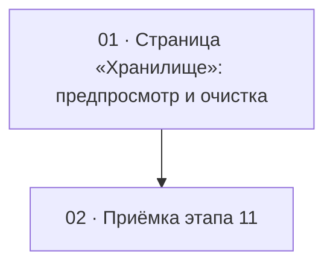

# Этап 11 — Очистка хранилища: страница «Хранилище»

Статус этапа: выполнен. Сводка —
[status.md](../status.md).

Источник: [03-technical-specification.md, раздел «Этап 11»](../../03-technical-specification.md#этап-11--очистка-хранилища).
Серверная сторона — этап 16 в `quizbeat-srv`
(`documentation/tasks/step-16/`), особенно
[задача 1](../../../../quizbeat-srv/documentation/tasks/step-16/01-storage-orphan-sweep.md).
Решения заказчика (2026-10-27): сборка мусора запускается кнопкой в
админке, доступна только `SUPER_ADMIN`, история запусков не нужна;
показывать число удалённых файлов и освобождённый объём.

Формат файлов — по [task-writing-guidelines.md](../task-writing-guidelines.md).

## Граф зависимостей

## Список задач

| #   | Задача                                                    | Зависит от                   | Файл                                                   | Статус    |
| --- | --------------------------------------------------------- | ---------------------------- | ------------------------------------------------------ | --------- |
| 1   | Стор, страница «Хранилище» и пункт меню для `SUPER_ADMIN` | серверный этап 16 (задача 1) | [01-storage-sweep-page.md](./01-storage-sweep-page.md) | выполнена |
| 2   | Приёмка этапа 11 целиком                                  | 1                            | [02-step11-acceptance.md](./02-step11-acceptance.md)   | выполнена |

## Решения этапа

- **Два шага: «Проверить» и «Удалить».** «Проверить» — `POST /storage/sweep` с
  `apply: false`: показывает, сколько файлов и мегабайт будет удалено. Кнопка
  удаления доступна только после предпросмотра с ненулевым результатом, с
  подтверждением, в котором указаны числа. Удаление необратимо, поэтому
  случайного запуска одним кликом нет.
- **Итог показывает число запуска, а не предпросмотра.** Между шагами
  набор кандидатов мог измениться; экран выводит ответ `apply: true`.
- **«Освобождено» — сумма размеров удалённых объектов**, не свободное место
  диска сервера (его API не отдаёт). Подпись на экране — «Освобождено», без
  слов «на диске».
- **Только `SUPER_ADMIN`.** Пункт меню и маршрут — как у сотрудников; `403`
  сервера всё равно обрабатывается.
- **Истории запусков нет.** Результат живёт в сторе до ухода со страницы и
  не сохраняется (решение заказчика).
- **Запрос синхронный и долгий.** Короткого таймаута нет, повтор запроса
  клиентом не делается; на время запроса кнопки заблокированы.
