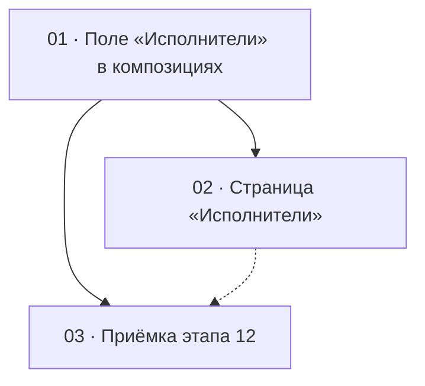

# Этап 12 — Исполнители вместо автора

Статус этапа: не выполнен. Сводка —
[status.md](../status.md).

Источник: [03-technical-specification.md, раздел «Этап 12»](../../03-technical-specification.md#этап-12--исполнители-вместо-автора).
Серверная сторона — этап 17 в `quizbeat-srv`
(`documentation/tasks/step-17/`), особенно
[задача 2](../../../../quizbeat-srv/documentation/tasks/step-17/02-staff-artists-and-compositions.md).
Продуктовое решение заказчика (2026-10-31) и модель —
[performers.md](https://github.com/evilice/quizbeat-docs/blob/main/product/performers.md):
поле «Автор» заменяется необязательным множественным полем «Исполнители».

Формат файлов — по [task-writing-guidelines.md](../task-writing-guidelines.md).

## Граф зависимостей

## Список задач

| #   | Задача                                                                          | Зависит от                   | Файл                                                       | Статус       |
| --- | ------------------------------------------------------------------------------- | ---------------------------- | ---------------------------------------------------------- | ------------ |
| 1   | Стор исполнителей, поле «Исполнители» в создании, правке, списке, карточке      | серверный этап 17 (задача 2) | [01-composition-artists-field.md](./01-composition-artists-field.md) | не выполнена |
| 2   | Страница «Исполнители»: список, переименование, удаление неиспользуемых — **можно отложить** | 1                            | [02-artists-page.md](./02-artists-page.md)                 | не выполнена |
| 3   | Приёмка этапа 12 целиком                                                        | 1 (и 2, если сделана)        | [03-step12-acceptance.md](./03-step12-acceptance.md)       | не выполнена |

Задача 2 необязательна для закрытия серверной задачи 4 (удаление колонки):
исполнителей можно создавать прямо в форме композиции. Без страницы составные
значения, перенесённые миграцией из `author`, нельзя переименовать — поэтому
её стоит сделать сразу следом.

## Решения этапа

- **Поле «Исполнители» — не обязательное.** Композицию можно сохранить без
  исполнителей (народная песня, саундтрек), в том числе опубликованную.
  Валидации «Укажите автора» больше нет.
- **Выбор — `Autocomplete` с множественным выбором и поиском на сервере**
  (`GET /artists?search=`), а не загрузка всего справочника, как у тегов:
  исполнителей много и они не ограничены ~50. Опция «создать «…»» создаёт
  исполнителя `POST /artists` и сразу выбирает его.
- **Порядок значим.** Показывается и отправляется в порядке выбора;
  изменить порядок можно стрелками «выше/ниже» в чипе-списке (перетаскивание
  не нужно).
- **Подпись исполнителей — одна функция:** имена через запятую, пусто — «—».
  Её используют список, карточка, диалог удаления и заголовок.
- **Слово в интерфейсе — «Исполнитель/Исполнители»,** «автор» нигде не
  остаётся.
- **Нет окна совместимости:** админка этапа 12 выкатывается вместе с серверной
  задачей 2; старого поля `author` сервер уже не принимает.
