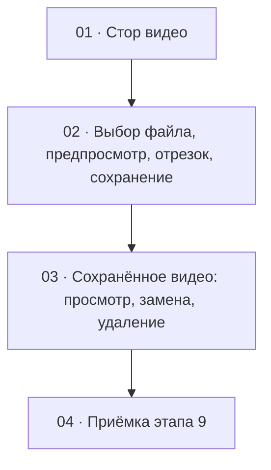

# Этап 9 — Видео композиции: декомпозиция на задачи

Источник: [03-technical-specification.md, раздел «Этап 9»](../../03-technical-specification.md#этап-9--видео-композиции).
Карта вызовов — [видео](../../02-staff-api.md#9-видео) (добавляется задачей 1).
Серверная сторона — этап 14 в `quizbeat-srv`
(`documentation/tasks/step-14/`), особенно
[задача 3](../../../../quizbeat-srv/documentation/tasks/step-14/03-composition-video-endpoints.md).
**Этап блокируется серверным этапом 14: эндпоинтов видео на сервере ещё
нет.** Поля запросов сверять с кодом сервера.

Формат файлов — по [task-writing-guidelines.md](../task-writing-guidelines.md).

## Что за этап

Контент-менеджер прикрепляет к композиции видео, которое клиент проиграет
при правильном ответе. Процесс (решение заказчика, 2026-10-11): выбрать
видеофайл → проиграть его → выбрать временной отрезок (по образцу
разметки аудио) → обрезать и сохранить. **Исходный файл не сохраняется** —
сервер получает его вместе с границами отрезка, вырезает фрагмент и
хранит только результат.

## Граф зависимостей

## Список задач

| # | Задача | Зависит от | Файл | Статус |
|---|--------|------------|------|--------|
| 1 | Стор видео: `POST/GET/DELETE .../video`, поля `videoUrl`/`videoDurationSec` из `GET /full` | серверный этап 14 (задача 3), [этап 4](../step-4/README.md) | [01-video-store.md](./01-video-store.md) | не выполнена |
| 2 | Выбор файла, локальный предпросмотр, выбор отрезка, отправка | 1 | [02-video-trim-editor.md](./02-video-trim-editor.md) | не выполнена |
| 3 | Блок на карточке: сохранённое видео, замена, удаление | 2 | [03-saved-video-block.md](./03-saved-video-block.md) | не выполнена |
| 4 | Приёмка этапа 9 целиком | 3 | [04-step9-acceptance.md](./04-step9-acceptance.md) | не выполнена |

## Решения этапа

- **Предпросмотр и выбор отрезка — полностью локально, до отправки.**
  Файл из input проигрывается через `URL.createObjectURL(file)` в
  `<video>`; на сервер ничего не уходит, пока не нажато «Сохранить».
  `URL.revokeObjectURL` — при смене файла и размонтировании.
- **Длительность исходника берётся из `<video>` (`loadedmetadata`).**
  Это отличается от аудио ([этап 5](../step-5/README.md#решения-по-открытым-вопросам-этапа):
  там длительность с сервера), потому что файла на сервере ещё нет;
  сервер всё равно перепроверяет границы по своей пробе, клиентская
  проверка — удобство, не защита.
- **Отрезок — два значения `startSec`/`endSec` с дробной частью**
  (MUI `Slider` с двумя ползунками, плюс поля ввода и кнопки «взять
  текущую позицию как начало/конец»). Новых зависимостей не заводим;
  волновая форма видео не нужна (для неё пришлось бы декодировать весь
  файл в браузере). Максимальная длина отрезка — константа клиента,
  зеркало серверной `VIDEO_MAX_CLIP_DURATION_SEC` (60 с); источник
  истины — сервер.
- **Форматы исходника: mp4 и webm, ориентир размера — 500 МБ**
  (`STORAGE_MAX_VIDEO_SIZE_BYTES`). `accept` у input и подсказка; MOV/MKV/
  AVI не предлагать. **Видео с iPhone (`.mov`, HEVC) вне этапа** — решение
  заказчика, 2026-10-11; в подсказке не обещать, при выборе `.mov`
  сервер ответит `415`. Если браузер не может проиграть файл
  (`error` у `<video>`), отправка блокируется с понятным текстом.
- **Результат — всегда mp4 ≤ 720 p**, формируется на сервере. После
  сохранения показывается именно он (`GET .../video`), не локальный файл.
- **Изменить границы уже сохранённого видео нельзя** — исходника нет;
  «Заменить» — это повторный выбор файла. UI прямо говорит об этом.
- **Обновление после мутаций (дополнение к
  [таблице этапа 8](../step-8/README.md#обновление-после-мутаций)):**
  `POST .../video` отвечает только `{ videoDurationSec }` без URL —
  после него `GET .../video`, старый `videoUrl` сбрасывается.
  `DELETE` (`204`) — обнулить оба поля в сторе. Протухшая ссылка —
  `GET .../video`, не повтор старой строки.
- **Долгая отправка.** Запрос синхронный (загрузка до 500 МБ +
  обрезка на сервере): индикатор «идёт загрузка и обрезка», блокировка
  повторной отправки и смены файла. Прогресс-бар — вне этапа.
- Этап не затрагивает сессии, роли и токены — обязательного человеческого
  ревью нет; `/code-review` на каждую задачу — по правилам.
